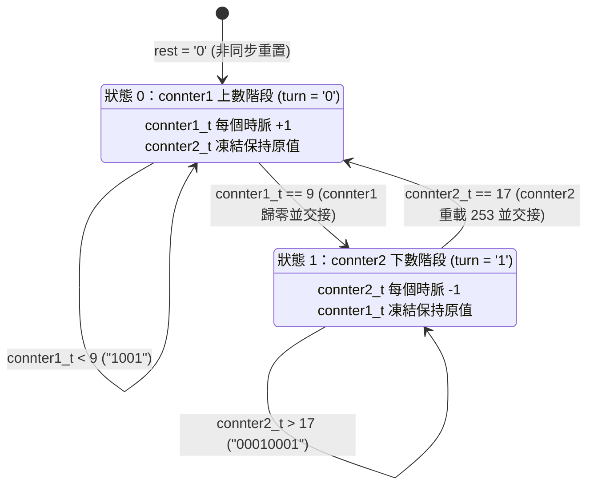

# HW1（無 `case` 版本）：雙計數器輪流控制電路

## 1. 程式簡介

本版本為 HW1 的基礎實作架構，採用**單一同步 `process`** 搭配 **`if-else` 條件判斷**與**致能旗標（`turn`）**，實現兩組計數器的輪流運作。

在硬體設計上，不額外宣告列舉型態（`enum`）的狀態機，而是直接利用一個 `1-bit` 的內部旗標訊號 `turn` 來記錄目前輪到哪一組計數器動作，並在同一時脈邊緣內同步完成計數值更新與控制權交接。此寫法結構緊湊、程式碼精簡，適合邏輯單純的雙向交替控制電路。

### 核心功能
* **上數計數器（`connter1`）**：4-bit 計數器，由 `0`（`"0000"`）向上遞增至 `9`（`"1001"`）。
* **下數計數器（`connter2`）**：8-bit 計數器，由 `253`（`"11111101"`）向下遞減至 `17`（`"00010001"`）。
* **單旗標輪流機制**：透過 `turn` 訊號進行硬體互斥（Mutual Exclusion），確保同一時間只有一組計數器在跳動，另一組則自動凍結維持原數值。

---

## 2. 狀態機介紹 (FSM)

雖然本程式未使用 `case` 敘述，但在硬體行為上仍構成一個以 `turn` 訊號為狀態暫存器的**兩狀態有限狀態機**。

### 狀態圖 (State Diagram)



### 狀態定義表

| `turn` 旗標值 | 運作階段 | `connter1_t` 行為 | `connter2_t` 行為 | 狀態切換條件 |
| :---: | :--- | :--- | :--- | :--- |
| `'0'` | 第一階段（上數） | 每個時脈週期加 1，數滿 `"1001"`（9）時歸零。 | 保持目前數值不變（待機凍結）。 | 當 `connter1_t` 達到 `"1001"` 時，將 `turn` 設為 `'1'`。 |
| `'1'` | 第二階段（下數） | 保持 `"0000"` 不變（待機凍結）。 | 每個時脈週期減 1，減至 `"00010001"`（17）時重載為 `"11111101"`（253）。 | 當 `connter2_t` 降至 `"00010001"` 時，將 `turn` 設為 `'0'`。 |

---

## 3. 程式介紹 (詳細)

本程式將所有循序邏輯集中於單一 `process(clk, rest)` 區塊中，透過巢狀 `if-else` 結構進行控制。

### 腳位介面定義 (Entity Port)
* `clk` (in)：系統時脈輸入，觸發所有同步計數與狀態切換。
* `rest` (in)：非同步重置訊號（低電位 `'0'` 有效）。
* `connter1 [3:0]` (out)：4-bit 輸出埠，顯示第一組上數計數器數值（0 ~ 9）。
* `connter2 [7:0]` (out)：8-bit 輸出埠，顯示第二組下數計數器數值（253 ~ 17）。

### 內部邏輯與設計重點拆解

#### (1) 非同步重置初始化區
```vhdl
if rest = '0' then 
    connter1_t <= "0000";
    connter2_t <= "11111101"; -- 253
    turn       <= '0';
```
當重置訊號 `rest` 拉低為 `'0'` 時，系統無需等待時脈邊緣，立即將 `connter1_t` 清零、`connter2_t` 載入初始值 `253`，並將控制權 `turn` 預設交給 `'0'`（由第一組計數器先啟動）。

#### (2) `if turn = '0'` 分支（上數控制邏輯）
* 在 `rising_edge(clk)` 觸發且 `turn = '0'` 時執行。
* 判斷 `connter1_t < "1001"` 是否成立：若未滿 9 則持續 `+ 1`；若已達 9，則在下一拍將 `connter1_t` 歸零，並同步執行 `turn <= '1'` 交出控制權。
* **隱含鎖存保持（Register Holding）**：在此分支中完全沒有對 `connter2_t` 賦值，在同步時脈電路中，硬體會自動透過正反器（Flip-Flop）的回授路徑維持 `connter2_t` 原值，不會產生組合邏輯 Latch。

#### (3) `else` 分支（下數控制邏輯）
* 當 `turn = '1'` 時進入此分支。
* 判斷 `connter2_t > "00010001"`（17）是否成立：若大於 17 則持續 `- 1`；若已達 17，則重新載入初始值 `"11111101"`（253），並將 `turn <= '0'` 交還控制權，完成一次完整的雙向輪流循環。