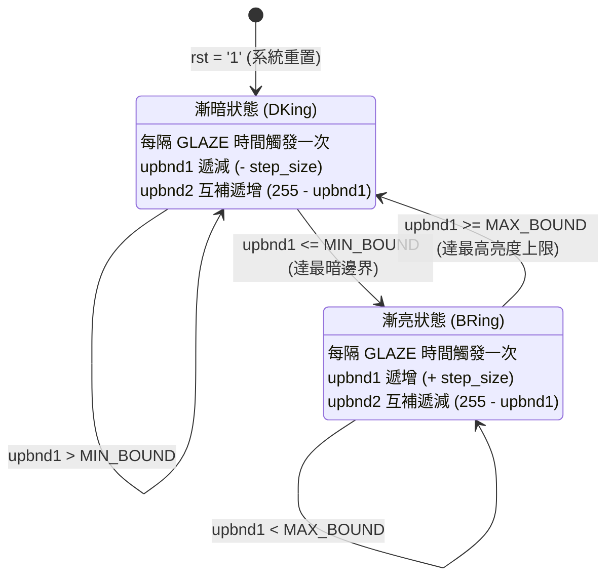

# HW2：多檔位動態呼吸燈控制系統

## 1. 程式簡介

本作業（HW2）採用**結構化設計（Structural Modeling）**，將 HW1 的動態 PWM 產生器作為底層子元件例化（Instantiation），並於頂層建立完整的控制系統，實現肉眼可見的 LED「漸亮（Breathing）」與「漸暗（Darkening）」呼吸燈效果。

### 核心功能
* **層級化模組整合**：頂層模組負責計算亮度比例，透過 `port map` 將亮滅上限動態傳遞給底層 `hw1` 執行高頻 PWM 切換。
* **互補亮度控制**：透過維持 `upbnd1 + upbnd2 = 255` 的互補關係，確保 PWM 載波頻率固定不閃爍，僅改變工作週期。
* **多維度硬體開關控制（加分項）**：支援透過開發板撥碼開關（SW0 ~ SW4）即時切換**呼吸週期（3s/5s/8s/10s）**、**最高亮度上限（50%/100%）**以及**亮度解析度（256階/64階）**。

---

## 2. 狀態機介紹 (FSM)

頂層控制器包含一個兩狀態的有限狀態機（`FSM_top`），用來切換呼吸燈處於「正在變暗（`DKing`）」或「正在變亮（`BRing`）」的階段。

### 狀態圖 (State Diagram)

### 狀態定義表

| 狀態名稱 | 意義 | `upbnd1`（亮燈時間）變化 | `upbnd2`（滅燈時間）變化 | 狀態轉移條件 |
| :--- | :--- | :--- | :--- | :--- |
| `DKing` | 漸暗階段 | 隨時間脈衝遞減 `step_size` | 隨之增加，維持總和 255 | 當 `upbnd1 <= MIN_BOUND`（降至最暗 0）時，轉移至 `BRing`。 |
| `BRing` | 漸亮階段 | 隨時間脈衝遞增 `step_size` | 隨之減少，維持總和 255 | 當 `upbnd1 >= MAX_BOUND`（升至最高亮度）時，轉移至 `DKing`。 |

---

## 3. 程式介紹 (詳細)

HW2 內部由「組合邏輯參數查表區」與「循序邏輯時序控制區」兩大部分構成。

### 腳位介面定義 (Entity Port)
* `clk` (in)：FPGA 系統主時脈。
* `rst` (in)：重置按鈕訊號（配合 EGO-XZ7 開發板 BTNC 設為高電位有效）。
* `gear_period [1:0]` (in)：SW1、SW0，控制完整呼吸一次的總週期（3秒、5秒、8秒、10秒）。
* `gear_bright` (in)：SW2，控制呼吸燈最高亮度上限（`'0'` 為 50% 亮度 127；`'1'` 為 100% 亮度 255）。
* `gear_res` (in)：SW4，控制調光解析度（`'0'` 為 256 階細緻平滑變化；`'1'` 為 64 階明顯階梯感）。
* `pwm` (out)：連接至開發板 LED0 的最終驅動訊號。

### 內部邏輯區塊拆解

#### (1) 元件例化 (`u_hw1 : hw1`)
將 `upbnd1` 與 `upbnd2` 連接至 `hw1` 的 `up1` 與 `up2` 輸入埠，讓底層高速執行 PWM 波形生成。

#### (2) 動態參數查表組合邏輯 (Combinational Processes)
* **亮度上限控制 (`gear_bright`)**：根據開關決定 `MAX_BOUND` 為 `127` 或 `255`。
* **解析度步進控制 (`gear_res`)**：決定每次亮度更新的跨度 `step_size`。高解析度時每次加減 `1`；低解析度時每次加減 `4`。
* **動態時基運算 (`gear_period`, `gear_res`)**：精確計算分頻上限 `GLAZE`。由於低解析度總步數變少（僅 1/4），程式會自動將 `GLAZE` 放大 4 倍，確保無論在哪種解析度下，3s/5s/8s/10s 的總呼吸時間依然精準不變。

#### (3) 分頻計時器 (`PWM_Timer`)
23-bit 循環計數器 `PWMcnt`。從 `0` 數到 `GLAZE` 後歸零，產生一個週期性的時間基準點（`PWMcnt = GLAZE`），用來控制亮度變化的節奏。

#### (4) 頂層狀態機 (`FSM_top`)
監控 `upbnd1` 是否觸及 `MIN_BOUND`（0）或 `MAX_BOUND`，控制呼吸方向的反轉。

#### (5) 亮度邊界運算單元 (`Upper_bound1` & `Upper_bound2`)
* **`Upper_bound1`**：每當 `PWMcnt = GLAZE` 成立時，依據目前狀態（`DKing` 或 `BRing`）對 `upbnd1` 進行加減 `step_size` 的運算，並包含防溢位保護（避免減至負數或超過 `MAX_BOUND`）。
* **`Upper_bound2`**：同步計算 `upbnd2 <= "11111111" - upbnd1`，確保高電位與低電位時間互補。