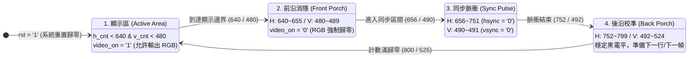
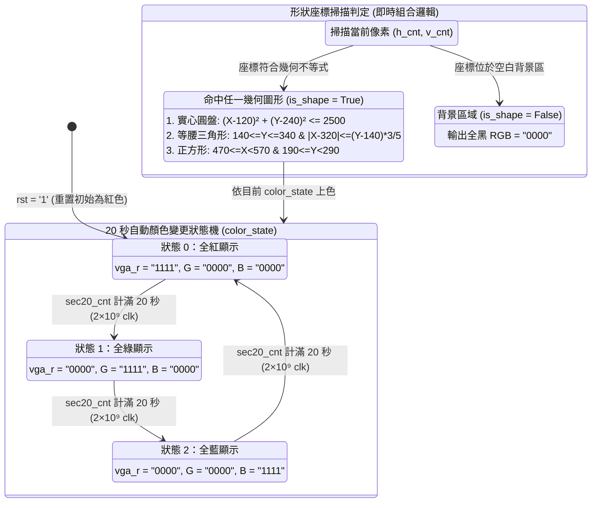

# HW3：VGA 掃描與圖形顯示控制系統介紹

## 1. 程式簡介

本專案為基於 EGO-XZ7 FPGA 開發板（系統時脈 100 MHz）與外接 VGA 擴充模組（透過 JA2 排針連接）的 **640×480 @ 60Hz 標準 VGA 顯示控制器**。程式從底層硬體時序出發，利用時脈致能（Clock Enable）產生精準的 25 MHz 像素取樣節拍，驅動水平同步（`HSYNC`）與垂直同步（`VSYNC`）訊號，並透過即時座標 `(h_cnt, v_cnt)` 的數學不等式運算，在螢幕上繪製幾何圖形（實心圓盤、等腰三角形、正方形），同時配備 20 秒自動變色狀態機（紅 $\rightarrow$ 綠 $\rightarrow$ 藍循環）。

### 核心硬體規格
* **顯示解析度與更新率**：640 × 480 @ 60 Hz（含飛回消隱區之總掃描框為 800 × 525）。
* **像素時脈致能 (`pclk_en`)**：25 MHz（由 100 MHz 系統時脈每 4 週期產生 1 次單週期高電位脈衝）。
* **色彩輸出深度**：RGB 各 4-bit（共 12 根訊號線驅動外接電阻網路 DAC，支援 16 階色彩變化，全亮為 `"1111"`）。
* **控制介面**：
  * `rst` (`P16` / BTNC)：高電位觸發系統重置。

---

## 2. 狀態機介紹 (FSM)

為清楚呈現系統運作架構，HW3 的狀態控制邏輯拆分為以下兩張獨立狀態圖：

### 圖一：VGA 掃描時序狀態機（獨立時序控制）

負責控制電子束在螢幕上的掃描節奏與消隱同步脈衝（640×480 @ 60Hz）：

---

### 圖二：形狀座標掃描與 20 秒顏色變更狀態機

負責即時判斷當前掃描座標 `(h_cnt, v_cnt)` 是否落在三個幾何圖形內，並依據 20 秒計時器切換統一顯示顏色：

---

### 狀態定義與轉移說明

| 狀態模組 | 狀態名稱 | 系統行為說明 | 狀態轉移條件 |
| :--- | :--- | :--- | :--- |
| **VGA 掃描時序** | `ACTIVE_DISPLAY` | `video_on = '1'`，座標位於 $640 \times 480$ 可視範圍內，依圖形邏輯輸出 RGB 電壓。 | `h_cnt` 達 640 或 `v_cnt` 達 480 時進入消隱區。 |
| **VGA 掃描時序** | `FRONT_PORCH` | 水平（16 clk）與垂直（10 行）前沿消隱區，`video_on = '0'` 強制關閉色彩輸出。 | 達同步區起始點（H: 656 / V: 490）進入同步脈衝。 |
| **VGA 掃描時序** | `SYNC_PULSE` | 送出低電位有效脈衝（`hsync = '0'` 維持 96 clk；`vsync = '0'` 維持 2 行）。 | 脈衝結束後（H: 752 / V: 492）進入後沿校準。 |
| **VGA 掃描時序** | `BACK_PORCH` | 水平（48 clk）與垂直（33 行）後沿，穩定螢幕黑電平基準。 | 計數滿 799 或 524 後歸零，重返 `ACTIVE_DISPLAY`。 |
| **形狀掃描判定** | `is_shape` | 即時比對當前像素是否位於圓盤、三角形或正方形內部。 | 命中圖形則送入顏色狀態機上色；否則輸出全黑背景。 |
| **自動變色 FSM** | `color_state (0~2)` | 依序將三個幾何圖形統一切換為全紅、全綠、全藍。 | 每計數 20 秒（$2 \times 10^9$ 個 100 MHz 時脈）切換至下一狀態。 |

---

## 3. 程式介紹 (詳細解析)

本系統全面採用 **100 MHz 單一時脈域搭配時脈致能（Clock Enable）** 與 **即時座標組合運算** 架構，確保硬體佈線（Routing）零時脈偏移，將設計拆解為 5 個獨立運作的硬體區塊：

### (1) 25 MHz 像素時脈致能產生器 (`pclk_en`)
* **設計目的**：避免使用除頻後的訊號直接當作其他 Process 的時脈輸入（容易造成 FPGA 內部 Clock Skew 導致螢幕抓不到訊號），統一由 100 MHz 主時脈驅動所有正反器。
* **運作細節**：利用 2-bit 計數器 `clk_cnt` 循環計數 `"00"` $\rightarrow$ `"11"`，每數滿 4 個週期便輸出一個維持 10 ns 的高電位脈衝 `pclk_en = '1'`，等效於精準的 25 MHz 取樣節拍。

### (2) 20 秒計時器與顏色切換狀態機 (`sec20_cnt`, `color_state`)
* **計時基準**：在 100 MHz 系統時脈（週期 10 ns）下，計數 `2,000,000,000` 個週期精準對應 20 秒。
* **顏色循環**：每當計數器達標歸零，`color_state` 便依序在 `0`（全紅）$\rightarrow$ `1`（全綠）$\rightarrow$ `2`（全藍）之間循環切換。

### (3) 水平與垂直掃描座標計數器 (`h_cnt`, `v_cnt`)
* **水平掃描 (`h_cnt`: 0 ~ 799)**：僅在 `pclk_en = '1'` 時遞增 1；當計數至 `799` 時歸零，並觸發垂直計數器進位。
* **垂直掃描 (`v_cnt`: 0 ~ 524)**：每掃描完一整條水平線遞增 1；當計數至 `524` 時歸零，完成每秒 60 次的畫面更新。

### (4) 同步脈衝與顯示區間解碼 (`hsync`, `vsync`, `video_on`)
* **組合邏輯即時比較**：
  * `hsync` 在 `h_cnt` 介於 `656 ~ 751`（`640 + 16` 至 `640 + 16 + 96 - 1`）時輸出 `'0'`，其餘為 `'1'`。
  * `vsync` 在 `v_cnt` 介於 `490 ~ 491`（`480 + 10` 至 `480 + 10 + 2 - 1`）時輸出 `'0'`，其餘為 `'1'`。
  * `video_on` 僅在 `h_cnt < 640` 且 `v_cnt < 480` 時為 `'1'`。

### (5) 平面幾何圖形數學運算與 RGB 上色輸出
利用當前掃描座標 `(h_cnt, v_cnt)` 直接在硬體中計算平面解析幾何不等式，並透過 `is_shape <= is_disk or is_tri or is_sq` 整合為單一圖形遮罩：
* **實心圓盤 (`is_disk`)**：圓心 `(120, 240)`、半徑 $R = 50$，判斷 $(X - 120)^2 + (Y - 240)^2 \le 2500$。
* **等腰三角形 (`is_tri`)**：頂點 `(320, 140)`、底邊高 `Y = 340`，判斷 $140 \le Y \le 340$ 且 $|X - 320| \le (Y - 140) \times \frac{3}{5}$。
* **正方形 (`is_sq`)**：判斷 $470 \le X < 570$ 且 $190 \le Y < 290$。
* **色彩輸出保護機制**：僅在 `video_on = '1'` 且 `is_shape = True` 時依照 `color_state` 輸出對應色光；其餘背景區與飛回消隱區一律輸出 `"0000"` 全黑，確保黑電平校準穩定。