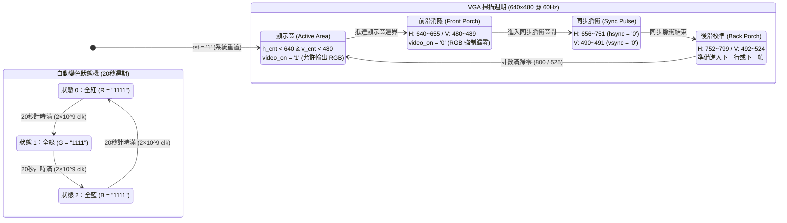

# HW3：VGA 掃描與圖形顯示控制系統介紹

## 1. 程式簡介

本專案為基於 EGO-XZ7 FPGA 開發板（系統時脈 100 MHz）與外接 VGA 擴充模組（透過 JA2 排針連接）的 **640×480 @ 60Hz 標準 VGA 顯示控制器**。程式從底層硬體時序出發，利用時脈致能（Clock Enable）產生精準的 25 MHz 像素取樣節拍，驅動水平同步（`HSYNC`）與垂直同步（`VSYNC`）訊號，並透過即時座標 `(h_cnt, v_cnt)` 的數學不等式運算，在螢幕上繪製基本 RGB 三色塊，以及進階的幾何圖形（實心圓盤、等腰三角形、空心圓圈、正方形）、16 階 RGB 漸層條與動態彈跳圓球。

### 核心硬體規格
* **顯示解析度與更新率**：640 × 480 @ 60 Hz（含飛回消隱區之總掃描框為 800 × 525）。
* **像素時脈致能 (`pclk_en`)**：25 MHz（由 100 MHz 系統時脈每 4 週期產生 1 次單週期高電位脈衝）。
* **色彩輸出深度**：RGB 各 4-bit（共 12 根訊號線驅動外接電阻網路 DAC，支援 16 階色彩變化，全亮為 `"1111"`）。
* **控制介面**：
  * `rst` (`P16` / BTNC)：高電位觸發系統重置。
  * `btn_change` (`T18` / BTNR)：配備硬體防彈跳（Debounce）之顯示模式切換按鍵。

---

## 2. 狀態機介紹 (FSM)

HW3 系統內部包含兩組獨立運作的狀態控制機制：**VGA 掃描時序狀態機**（負責控制電子束掃描與同步脈衝）以及 **進階顯示/自動變色狀態機**。

### 狀態圖 (State Diagram)

### 狀態定義與轉移說明

| 狀態模組 | 狀態名稱 | 系統行為說明 | 狀態轉移條件 |
| :--- | :--- | :--- | :--- |
| **VGA 掃描時序** | `ACTIVE_DISPLAY` | `video_on = '1'`，座標位於 $640 \times 480$ 可視範圍內，依圖形邏輯輸出 RGB 電壓。 | `h_cnt` 達 640 或 `v_cnt` 達 480 時進入消隱區。 |
| **VGA 掃描時序** | `FRONT_PORCH` | 水平（16 clk）與垂直（10 行）前沿消隱區，`video_on = '0'` 強制關閉色彩輸出。 | 達同步區起始點（H: 656 / V: 490）進入同步脈衝。 |
| **VGA 掃描時序** | `SYNC_PULSE` | 送出低電位有效脈衝（`hsync = '0'` 維持 96 clk；`vsync = '0'` 維持 2 行）。 | 脈衝結束後（H: 752 / V: 492）進入後沿校準。 |
| **VGA 掃描時序** | `BACK_PORCH` | 水平（48 clk）與垂直（33 行）後沿，穩定螢幕黑電平基準。 | 計數滿 799 或 524 後歸零，重返 `ACTIVE_DISPLAY`。 |
| **自動變色 FSM** | `color_state (0~2)` | 依序將幾何圖形（圓盤、三角形、正方形）統一切換為全紅、全綠、全藍。 | 每計數 20 秒（$2 \times 10^9$ 個 100 MHz 時脈）切換至下一狀態。 |

---

## 3. 程式介紹 (詳細解析)

本系統全面採用 **100 MHz 單一時脈域搭配時脈致能（Clock Enable）** 與 **即時座標管線運算** 架構，確保硬體佈線（Routing）零時脈偏移，將設計拆解為 6 個獨立運作的硬體區塊：

### (1) 25 MHz 像素時脈致能產生器 (`pclk_en`)
* **設計目的**：避免使用除頻後的訊號直接當作其他 Process 的時脈輸入（容易造成 FPGA 內部 Clock Skew 導致螢幕抓不到訊號），統一由 100 MHz 主時脈驅動所有正反器。
* **運作細節**：利用 2-bit 計數器 `clk_cnt` 循環計數 `"00"` $\rightarrow$ `"11"`，每數滿 4 個週期便輸出一個維持 10 ns 的高電位脈衝 `pclk_en = '1'`，等效於精準的 25 MHz 取樣節拍。

### (2) 水平與垂直掃描座標計數器 (`h_cnt`, `v_cnt` 與 `frame_tick`)
* **水平掃描 (`h_cnt`: 0 ~ 799)**：僅在 `pclk_en = '1'` 時遞增 1；當計數至 `799` 時歸零，並觸發垂直計數器進位。
* **垂直掃描 (`v_cnt`: 0 ~ 524)**：每掃描完一整條水平線遞增 1；當計數至 `524` 時歸零，代表完成一幀畫面，同時產生單週期脈衝 `frame_tick = '1'`（頻率精準為 60 Hz），作為動畫更新的時間基準。

### (3) 同步脈衝與顯示區間解碼 (`hsync`, `vsync`, `video_on`)
* **組合邏輯即時比較**：
  * `hsync` 在 `h_cnt` 介於 `656 ~ 751`（`640 + 16` 至 `640 + 16 + 96 - 1`）時輸出 `'0'`，其餘為 `'1'`。
  * `vsync` 在 `v_cnt` 介於 `490 ~ 491`（`480 + 10` 至 `480 + 10 + 2 - 1`）時輸出 `'0'`，其餘為 `'1'`。
  * `video_on` 僅在 `h_cnt < 640` 且 `v_cnt < 480` 時為 `'1'`。

### (4) 按鈕防彈跳與模式切換控制器 (`Debounce & Mode Control`)
* **雙級同步器 (`btn_sync0`, `btn_sync1`)**：將外部非同步按鍵訊號同步至 100 MHz 時脈域，消除亞穩態（Metastability）風險。
* **20-bit 穩定計數器 (`db_cnt`)**：當按鍵電位持續穩定達 `x"FFFFF"`（約 10.48 ms）後才更新去彈跳後的訊號 `btn_debounced`，並透過上升緣偵測（`btn_debounced = '1' and btn_prev = '0'`）確保每按一次按鍵精準切換一個顯示模式（`mode 0 ~ 3`）。

### (5) 平面幾何圖形數學運算單元 (`is_disk`, `is_tri`, `is_ring`, `is_sq`)
直接利用當前電子束掃描座標 `(h_cnt, v_cnt)` 在組合邏輯中計算平面解析幾何不等式：
* **實心圓盤 (`is_disk`)**：圓心 `(120, 240)`、半徑 $R = 50$，判斷 $(X - 120)^2 + (Y - 240)^2 \le 2500$。
* **等腰三角形 (`is_tri`)**：頂點 `(320, 140)`、底邊高 `Y = 340`，判斷 $140 \le Y \le 340$ 且 $|X - 320| \le (Y - 140) \times \frac{3}{5}$。
* **空心圓圈 (`is_ring`)**：圓心 `(520, 240)`、內半徑 30、外半徑 50，判斷 $900 \le (X - 520)^2 + (Y - 240)^2 \le 2500$。
* **正方形 (`is_sq`)**：判斷 $470 \le X < 570$ 且 $190 \le Y < 290$。
